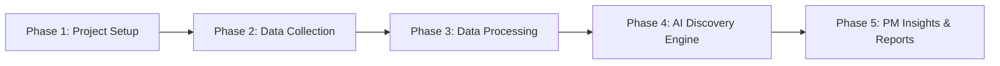
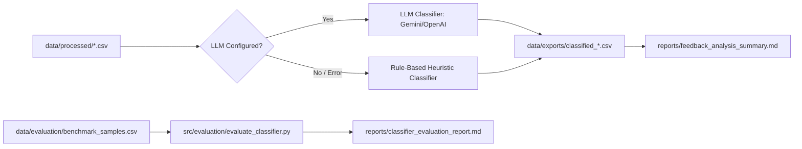

# AI-Powered Discovery Engine: First-Time Mutual Fund SIP Retention & Churn

## 1. Project Objective

The primary objective of this project is to build an **AI-powered discovery engine** for product management research. It analyzes publicly available user feedback to understand the behavioral, emotional, and platform-driven reasons why first-time mutual fund investors decide to **continue, pause, reduce, or stop** their Systematic Investment Plans (SIPs) within their first 12 months.

By analyzing unstructured feedback (app reviews, community forum threads, and user discussions), the engine extracts actionable insights to help product managers design better onboarding experiences, nudges, retention mechanisms, and support features for retail investors.

---

## 2. Main Research Questions

This discovery engine aims to answer key product and behavioral questions:

1. **Drop-off Drivers (Why Stop or Pause?):**
   - What triggers first-time investors to pause or cancel SIPs within the first 3, 6, or 12 months?
   - How much churn is driven by market volatility (loss aversion) versus platform friction (mandate failures, confusing UI, hidden fees)?
2. **Amount Reduction (Why Reduce?):**
   - What drives users to downgrade SIP ticket sizes? Is it personal liquidity constraints, unmet return expectations, or difficulty managing monthly cash flows?
3. **Continuation & Growth (Why Continue or Step-up?):**
   - What features, educational nudges, or product experiences give first-time investors the confidence to maintain or increase their SIP contributions?
4. **Platform Friction & Feature Gaps:**
   - What are the recurring user pain points across popular investment apps (e.g., Zerodha Coin, Groww, Kuvera, ET Money, INDmoney) regarding autopay mandates, bank re-authorizations, and portfolio tracking?
5. **Investor Personas & Lifecycle Stages:**
   - Can we segment first-time SIP investors into distinct personas (e.g., *Anxious Novice*, *Passive Saver*, *Goal-Oriented Investor*, *Yield Chaser*) based on their feedback language?

---

## 3. Planned Data Sources

To capture authentic and diverse user feedback, the engine will ingest data from public channels:

- **App Store Reviews (Google Play Store & Apple App Store):**
  - Public reviews and ratings from leading investment apps (e.g., Groww, Zerodha Coin, Indmoney, Angel One, Kuvera, ET Money).
- **Online Communities & Public Forums:**
  - Reddit discussions from personal finance communities (e.g., `r/IndiaInvestments`, `r/personalfinanceindia`).
- **Consumer Feedback & Complaint Forums:**
  - Publicly accessible consumer forums and feedback portals discussing SIP setup issues, bank auto-debit glitches, and refund queries.

---

## 4. Proposed Technology Stack

- **Core Programming Language:** Python 3.10+
- **Data Manipulation & Storage:**
  - `pandas`: Tabular data cleaning, merging, and filtering.
- **Environment & Configuration Management:**
  - `python-dotenv`: Safe management of local environment variables and configurations.
- **Testing & Quality Assurance:**
  - `pytest`: Automated test suite for data ingestion and pipeline validation.
- **Natural Language Processing & AI (Planned for future phases):**
  - Large Language Model APIs (e.g., Google Gemini or OpenAI) for sentiment analysis, thematic discovery, and intent categorization.
  - Sentence embeddings or topic modeling libraries for semantic clustering.
- **Reporting & Visualization (Planned for future phases):**
  - Markdown/HTML summary reports and chart generation (e.g., `matplotlib` / `seaborn`).

---

## 5. Implementation Roadmap

This project is built incrementally following a structured approach:



- **Phase 1: Project Setup & Baseline Architecture (Current Step)**
  - Establish folder hierarchy, environment configuration, dependency management, entry point, and test harness.
- **Phase 2: Data Collection & Ingestion**
  - Build modular collectors to gather public user reviews and forum discussions without rate-limit issues.
- **Phase 3: Data Cleaning & Preprocessing**
  - Normalize text, remove spam/duplicates, filter for relevant SIP lifecycle keywords (continue, pause, stop, mandate, returns).
- **Phase 4: AI-Powered Discovery & Sentiment Engine**
  - Apply LLM analysis and NLP clustering to classify feedback by action (Continue / Pause / Reduce / Stop) and underlying root causes.
- **Phase 5: Product Management Insights & Reporting**
  - Generate comprehensive findings, investor persona breakdowns, and actionable product recommendations with supporting figures.

---

## 6. Ethical Public Feedback Collection Guidelines

When collecting public user feedback for Groww and retail mutual fund research, we adhere to strict ethical standards:

### 1. Public Accessibility & Platform Terms
- **Public Domain Only:** Collect feedback exclusively from publicly accessible pages (e.g., Google Play Store public reviews, public Reddit threads in `r/IndiaInvestments` and `r/personalfinanceindia`, public investment forums).
- **Terms of Service Compliance:** Respect each platform's Terms of Service, robot exclusion standards (`robots.txt`), and API rate limits.
- **No Bypassing Controls:** Never bypass paywalls, private forum gates, or authentication screens.

### 2. Privacy & PII (Personally Identifiable Information) Redaction
- **Zero PII Storage:** Redact and exclude all personally identifiable information, including:
  - Real names and personal usernames/handles
  - Phone numbers, email addresses, and home addresses
  - Bank account numbers, folio numbers, UPI IDs, and transaction reference numbers
- **Aggregation Focus:** Analysis focuses on aggregated behavioral trends, emotional triggers, and friction patterns rather than individual users.

### 3. Prohibition of Private Communications
- Never collect or store private communications, such as direct messages (DMs), private customer support transcripts, or gated community chats.

### 4. Data Authenticity & Integrity
- **No Fabricated Feedback:** Never invent, hallucinate, or alter user reviews. Synthetic data must never be passed off as authentic customer evidence in product management reports.
- **Traceability:** Maintain public `source_url` references for each collected feedback item to verify authenticity during PM evaluation.

### 5. Research & Product Improvement Context
- Data is utilized solely for product discovery, user experience analysis, and academic research to understand retention hurdles for first-time mutual fund investors on platforms like Groww.
- Data will never be sold, re-distributed, or used for targeted advertising or user de-anonymization.

### 6. Respect for Deletion
- If a post or review is deleted at the source or if an author requests removal, the corresponding record will be purged from both raw and processed datasets.

---

## 7. System Architecture

For a comprehensive technical architecture description with Mermaid data flow diagrams, see [docs/architecture.md](docs/architecture.md).



---

## 8. AI / LLM Configuration & Usage

The discovery engine supports multi-provider LLM classification with graceful rule-based fallback.

### Configuration via `.env`

Copy `.env.example` to `.env`:
```bash
copy .env.example .env
```

Set the provider and credentials in `.env`:
```env
# Provider choice: 'gemini', 'openai', or 'mock'
LLM_PROVIDER=gemini

# Model name (default: gemini-1.5-flash for Gemini, gpt-4o-mini for OpenAI)
LLM_MODEL=gemini-1.5-flash

# API Credentials (never commit this file)
GEMINI_API_KEY=your_actual_gemini_api_key_here
```

### Fallback Guarantee
- **Zero Credentials:** If `GEMINI_API_KEY` or `OPENAI_API_KEY` are omitted, the engine automatically runs the rule-based keyword classifier without errors or network calls.
- **API Failure / Rate Limits:** If a paid API call times out or encounters HTTP 429/500 errors, the engine catches the exception, logs a warning, and falls back to rule-based classification for that specific record.

---

## 9. Running Pipelines & Evaluation

### 1. Run Data Cleaning Pipeline
```bash
.venv\Scripts\python.exe src/processing/clean_feedback.py
```
Outputs cleaned CSVs into `data/processed/`.

### 2. Run Feedback Theme Classification
```bash
.venv\Scripts\python.exe src/analysis/theme_classifier.py
```
Exports classified datasets to `data/exports/` and generates `reports/feedback_analysis_summary.md`.

### 3. Run Benchmark Evaluation & Model Comparison
```bash
.venv\Scripts\python.exe -m src.evaluation.evaluate_classifier
```
Compares rule-based vs LLM classifications against the curated 25-record benchmark, reporting accuracy and disagreement analysis in `reports/classifier_evaluation_report.md`.

### 4. Run Automated Test Suite
```bash
.venv\Scripts\python.exe -m pytest tests/ -v
```

---

## 10. Troubleshooting & Common Issues

| Issue | Cause | Solution |
|:---|:---|:---|
| `python : Python was not found` | Global Python execution alias not set on Windows | Use the virtual environment Python directly: `.venv\Scripts\python.exe` |
| `LLM classification failed: HTTP 403 / 401` | Invalid or expired API key | Verify your `GEMINI_API_KEY` or `OPENAI_API_KEY` in `.env` |
| `LLM classification failed: timeout` | Network latency or firewall block | The pipeline automatically uses rule-based fallback; check internet connection |
| Ambiguous / uncertain reviews in report | Feedback text was off-topic or lacked investment context | Engine deliberately tags this as `Uncertain / Ambiguous Feedback` to prevent false conclusions |
| Stock SIPs appearing in mutual fund report | Accidental mixing of asset classes | Stock SIPs are isolated to `reddit_groww_stock_sip_cleaned.csv` and excluded from mutual fund metrics |

