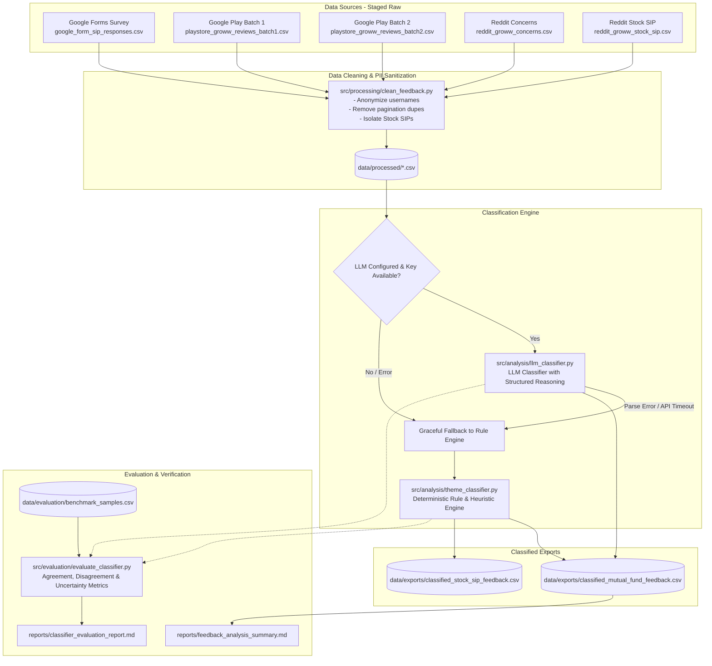

# System Architecture: AI-Powered SIP Retention Discovery Engine

## 1. System Overview

The **Groww SIP Retention Discovery Engine** is an incremental product discovery platform designed to analyze public user feedback and survey responses to understand why first-time mutual fund investors continue, pause, reduce, or stop their Systematic Investment Plans (SIPs) during their first 12 months.

The system combines:
1. **Deterministic Data Cleaning & PII Auditing**: Anonymizes user identities, strips duplicates, and standardizes multi-channel inputs.
2. **Rule-Based Baseline Classifier**: Fast, deterministic keyword regex and survey logic matching that guarantees zero external dependencies and 100% offline uptime.
3. **Configurable LLM Classification Layer**: An AI classification and reasoning component that analyzes nuanced, conversational investor feedback, extracts verbatim supporting evidence, and flags ambiguity.
4. **Evaluation & Verification Harness**: Quantitatively compares rule-based vs. LLM classifications against a curated benchmark, surfacing agreements, disagreements, and uncertainty.

---

## 2. Component Architecture & Responsibilities

---

## 3. Module Breakdown & Reusability Map

| Component / File | Status | Responsibility | Reusability Rationale |
|:---|:---|:---|:---|
| `data/raw/*` | **Preserved** | Read-only raw research artifacts | Never modified to maintain data provenance and reproducibility. |
| `src/processing/clean_feedback.py` | **Reused as-is** | Deduplication, PII masking, schema standardization | Validated with 5 automated tests; robustly produces cleaned files in `data/processed/`. |
| `src/analysis/theme_classifier.py` | **Reused as Baseline** | Rule-based regex and survey mapping; dataclasses | Serves as deterministic ground-floor baseline, fast offline pipeline, and fallback for LLM failures. |
| `src/analysis/llm_classifier.py` | **New Component** | Provider-agnostic LLM client (Gemini/OpenAI/Mock) | Handles structured prompt engineering, JSON schema parsing, and quote extraction. |
| `src/evaluation/evaluate_classifier.py` | **New Component** | Accuracy, agreement matrix, and uncertainty auditor | Compares rule-based vs LLM predictions against manually verified benchmark. |
| `data/evaluation/benchmark_samples.csv` | **New Dataset** | 25 curated, multi-source records with verified ground truth | Enables deterministic evaluation and CI regression testing. |
| `reports/feedback_analysis_summary.md` | **Reused & Updated** | High-level synthesis report of discovered themes | Updated automatically when pipeline executes. |

---

## 4. Data Flow Pipeline

1. **Ingestion & Privacy Sanitization (`src/processing/clean_feedback.py`)**:
   - Reads 5 staged CSV files from `data/raw/`.
   - Strips identifiable user handles (`user_id`, author usernames).
   - Filters out 504 exact pagination duplicate review rows from Play Store scrapers.
   - Saves clean, structured datasets to `data/processed/`.
   - **Strict Constraint**: Isolates single-stock SIPs into `reddit_groww_stock_sip_cleaned.csv` to avoid polluting mutual fund retention findings.

2. **Classification Routing (`src/analysis/llm_classifier.py`)**:
   - Checks environment variables (`LLM_PROVIDER`, `GEMINI_API_KEY`, `OPENAI_API_KEY`).
   - If keys are missing, inactive, or invalid, logs an informative notice and routes transparently to the rule-based classifier (`src/analysis/theme_classifier.py`).
   - If configured, batches prompt requests with explicit JSON schema constraints:
     - Must select from the 9 established SIP themes.
     - Must extract verbatim `supporting_evidence` substring from the input text.
     - Must assign confidence (`high`, `medium`, or `uncertain`).
     - Must mark ambiguous or off-topic records as `Uncertain / Ambiguous Feedback`.

3. **Fallback & Error Handling**:
   - If an LLM call fails (HTTP 429 rate limit, 5xx server error, timeout, or invalid JSON payload), the engine catches the exception and immediately invokes the rule-based classifier for that record.
   - The failure reason is logged, ensuring the pipeline runs to completion without crashing.

4. **Evaluation & Verification (`src/evaluation/evaluate_classifier.py`)**:
   - Runs both classifiers across the curated benchmark dataset.
   - Computes:
     - Exact match agreement rate.
     - Ambiguity/uncertainty identification rate.
     - Disagreement breakdown table with rationale.
   - Emits markdown evaluation metrics in `reports/classifier_evaluation_report.md`.

---

## 5. Technology Choices & Design Decisions

1. **Standard Library HTTP Client (`urllib.request`)**:
   - Utilizes Python's standard library for REST API calls to LLM endpoints.
   - *Advantage*: No heavy third-party SDK dependencies (e.g., massive grpc or openai wheels) required for initial setup, keeping the environment lightweight, beginner-friendly, and portable.
2. **Environment Variable Configuration (`python-dotenv`)**:
   - Keys (`GEMINI_API_KEY`, `OPENAI_API_KEY`) are read strictly from `.env`.
   - Zero hardcoded secrets; `.env` is tracked in `.gitignore`.
3. **Strict Domain Segregation**:
   - Mutual fund SIP retention is governed by long-term compounding, rupee-cost averaging, and NAV market cycles.
   - Stock SIPs involve individual stock volatility and broker delivery/brokerage fee friction. Keeping them strictly partitioned avoids distorted product insights.
4. **Non-Invention & Evidence Traceability**:
   - LLMs are prohibited from hallucinating user intent. Every classification requires an exact quotation from `feedback_text` in `supporting_evidence`.
